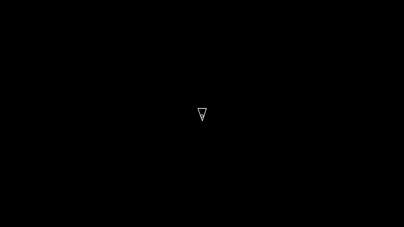

# Asteroids

**Build notes:** [Building Asteroids — Engineering Notebook](https://github.com/TheMoeaegon/engineering-notebook/blob/master/build-asteroids.md)

A clone of the classic arcade game **Asteroids**, built with Python and Pygame as a
guided project on [boot.dev](https://www.boot.dev/courses/build-asteroids-python).

Fly a triangular ship through an endless field of drifting rocks, blast them into
smaller pieces, and try not to get hit.



<p align="center"><em><a href="assets/demo.mp4">▶ Watch the full-quality demo (MP4)</a></em></p>

## Features

- **Player ship** with rotation and forward/backward thrust
- **Endless asteroid field** spawning off-screen edges at random speeds and angles
- **Shooting** with a 0.3 s cooldown between shots
- **Collision detection** — shots split asteroids into smaller ones; a single hit
  on the player ends the run
- **Object-oriented design** — every game object derives from a shared `CircleShape`
  base class and lives in Pygame sprite groups
- **Game logging** — state snapshots and events (`player_hit`, `asteroid_shot`,
  `asteroid_split`) written as JSONL

## Controls

| Key | Action |
| --- | --- |
| `A` / `D` | Rotate left / right |
| `W` / `S` | Thrust forward / backward |
| `Space` | Shoot |
| Window close | Quit |

## Requirements

- Python **3.13+**
- [Pygame](https://www.pygame.org/) 2.6.1 (declared in `pyproject.toml`)
- [uv](https://docs.astral.sh/uv/) (recommended) or `pip`

## Getting started

```bash
git clone https://github.com/TheMoeaegon/asteroids.git
cd asteroids
uv sync
uv run main.py
```

Using plain `pip` instead:

```bash
python -m venv .venv
source .venv/bin/activate
pip install pygame==2.6.1
python main.py
```

## Project structure

| File | Purpose |
| --- | --- |
| `main.py` | Game loop: input, updates, collisions, rendering |
| `constants.py` | Tuning values for the screen, player, asteroids, and shots |
| `circleshape.py` | Base sprite with position, velocity, radius, and collision math |
| `player.py` | Player ship: rotation, movement, shooting cooldown |
| `asteroid.py` | Asteroid sprite and the split-into-smaller-rocks logic |
| `asteroidfield.py` | Spawner that emits asteroids from the screen edges |
| `shot.py` | Projectile fired by the player |
| `logger.py` | JSONL logging of game state and events |

## How it works

Every object is a circle under the hood, which keeps collision detection cheap:

```python
distance = pygame.math.Vector2.distance_to(position_a, position_b)
collided = distance <= radius_a + radius_b
```

Movement uses `pygame.Vector2`, so the ship and asteroids can be rotated by
degrees and scaled by speed without any trigonometry. Asteroids are destroyed by
calling `Asteroid.split()`, which removes the current rock and creates two
smaller, faster ones unless it is already at `ASTEROID_MIN_RADIUS`.

## Credits

This project follows the guided course
**[Build Asteroids using Python and Pygame](https://www.boot.dev/courses/build-asteroids-python)**,
created by [boot.dev](https://www.boot.dev) and taught by Sarah Schulte.

Many thanks to boot.dev for laying out the concepts — the game loop, sprite
groups, vector math, and collision handling — in such a hands-on way.
The code here is my own implementation built while working through the lesson;
it is not affiliated with or endorsed by boot.dev.

## Notes

- `game_state.jsonl` and `game_events.jsonl` are generated at runtime and are
  intentionally ignored by git.
- `assets/demo.gif` and `assets/demo.mp4` are captures of the game running at
  1280×720.
